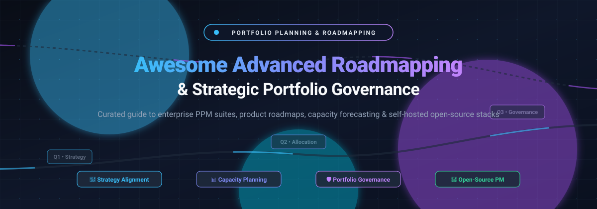
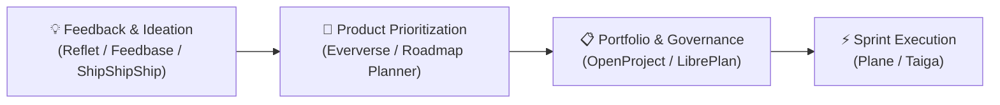

# 🌟 Awesome Advanced Roadmapping & Portfolio Planning 🚀

  

  
  
  
  
  
  
  

---

## 🧭 Executive Summary & SEO Overview

Welcome to the definitive curated index of **Advanced Product Roadmapping**, **Project Portfolio Management (PPM)**, **Resource Capacity Planning**, and **Strategy-to-Execution Governance Tools**. Whether you are an enterprise PMO architect evaluating multi-million dollar portfolio suites with Monte Carlo scenario simulations or an engineering lead deploying self-hosted, sovereign open-source agile roadmaps, this repository provides deep, factual, and benchmarked comparisons.

### 🔍 Key Capabilities & Search Terms
`Product Roadmaps` • `Project Portfolio Management (PPM)` • `Strategic Portfolio Management (SPM)` • `Capacity Planning & Resource Heatmaps` • `Strategy-to-Execution Alignment` • `Scenario Modeling` • `Enterprise Agile Planning (SAFe)` • `Open-Source PM Tools` • `Self-Hosted Product Operations` • `Customer Feedback Prioritization`

---

## 📑 Table of Contents

- [📊 Sector Overview & Market Dynamics](#-sector-overview--market-dynamics)
- [🏢 SaaS & Hosted Enterprise Platforms](#-saas--hosted-enterprise-platforms)
- [💻 Open-Source GitHub Projects](#-open-source-github-projects)
- [🛠️ Architectural Stacks & Custom Assemblies](#️-architectural-stacks--custom-assemblies)
- [🤝 How to Contribute](#-how-to-contribute)
- [☕ Support & Community](#-support--community)
- [📈 Star History](#-star-history)
- [⚖️ Disclaimer & Governance Notes](#️-disclaimer--governance-notes)

---

## 📊 Sector Overview & Market Dynamics

The global **Project Portfolio Management (PPM)** and **Strategic Roadmapping** software market is valued at approximately **$7.0B to $9.8B** and is projected to expand past **$15B+ by the early 2030s** at an estimated **8% to 12.8% CAGR**. 

Market concentration follows a **two-tier hybrid structure**:
1. **Moderately Concentrated at the Enterprise PMO Tier**: Large-scale strategic portfolio suites (e.g., Atlassian, Planview, Smartsheet) dominate corporate governance and compliance contracts with complex financial models, multi-level OKRs, and cross-division capacity heatmaps.
2. **Highly Fragmented Across Mid-Market & Product Discovery**: A diverse ecosystem of modern product discovery tools (e.g., Productboard, Aha!, Airfocus, Dragonboat) and open-source self-hosted alternatives actively compete without a single winner-take-all monopoly.

---

## 🏢 SaaS & Hosted Enterprise Platforms

> All SaaS platforms below are ranked in descending order by **Company Scale (Valuation or Annual Recurring Revenue)**. Starting tier pricing reflects publicly verifiable baselines (annual billing terms where applicable).

| 🏷️ Platform | 💰 Company Scale (Valuation / Revenue) | 💳 Pricing (Starting Tier) | 🎁 Free Tier / Free Trial Limits | 🎯 Key Capabilities & Target Use Case |
| :--- | :--- | :--- | :--- | :--- |
| **[Jira Plan (Advanced Roadmaps)](https://www.atlassian.com/software/jira)** | ~$52B Market Cap (Atlassian) / ~$4.1B+ Revenue | **$14.50/user/month** (billed annually as Jira Cloud Premium; $16.00/mo monthly) | **Free forever plan limited to 10 users** with 2 GB storage and basic single-project boards (Advanced Roadmaps cross-project planning requires Premium trial or upgrade) | Portfolio planning embedded directly in Jira for cross-team dependency mapping, capacity planning, and scenario modeling across Atlassian ecosystems. |
| **[Monday Dev](https://monday.com/)** | ~$10B Market Cap (Monday.com) / ~$970M+ Revenue | **$9/seat/month** (billed annually as Basic Dev; **3-seat minimum = $27/month**) | **14-day free trial** of Pro features (full team access; no permanent free tier on monday dev) | Product development workflows within the Monday Work OS featuring sprint management, roadmaps, and cross-functional capacity views. |
| **[Smartsheet Portfolio](https://www.smartsheet.com/)** | $8.4B Acquisition Valuation (Vista & Blackstone) / ~$1.1B ARR | **$9/user/month** (billed annually as Pro Plan; $12/mo monthly; 1–10 members max) | **30-day free trial** of Business plan (capped at 50 sheets created, 100 automated daily emails; permanent free tier closed to new users) | Spreadsheet-native portfolio management combining Gantt schedules, resource views, portfolio rollups, and automated workflows. |
| **[Productboard](https://www.productboard.com/)** | $1.72B Valuation (Series D) / ~$70M+ ARR | **$19/maker/month** (billed annually as Essentials; free unlimited viewers/contributors) | **Free forever plan limited to 500 feedback notes**, 1 teamspace, and basic AI credits; plus **15-day free trial** of Pro plan | Customer feedback aggregation, product discovery prioritization scoring, and stakeholder-facing roadmap visualization. |
| **[Planview](https://www.planview.com/)** | ~$1.6B+ PE Valuation / ~$500M Revenue | **$19/user/month** (starting tier for ProjectPlace/AgilePlace; Enterprise Portfolios is custom quote) | **30-day free trial** (AgilePlace/ProjectPlace fully functional, unlimited boards/Gantt charts; Portfolios available via sales demo) | Enterprise-scale strategic portfolio planning, multi-year financial governance, resource heatmaps, and enterprise work management. |
| **[Aha!](https://www.aha.io/)** | ~$50M+ ARR (Bootstrapped & profitable) | **$59/user/month** (billed annually as Roadmaps Premium; $74/mo monthly) | **30-day free trial** (fully functional access to all features, scorecards, whiteboards, and knowledge base; no permanent free tier) | Comprehensive end-to-end product development suite covering strategy, scoring, roadmap visualizers, and idea portals. |
| **[ProductPlan](https://www.productplan.com/)** | Growth Stage (~$10M+ ARR est.) | **$39/editor/month** (billed annually as Basic tier; free unlimited roadmap viewers) | **14-day free trial** (fully functional editor access without credit card; transitions to read-only mode after trial) | Clean visual roadmapping and timeline planning platform optimized for intuitive drag-and-drop stakeholder presentations. |
| **[Airfocus](https://airfocus.com/)** | Early/Growth Stage VC-backed (~$5M–$10M ARR est.) | **$59/user/month** (billed annually as Core/Team tier; free viewers) | **Sales-assisted trial / demo only** (no permanent free tier; guided evaluation workspace provided on request) | Modular product management platform with customizable prioritization scoring matrices, OKR tracking, and multi-portfolio roadmap views. |
| **[Roadmunk](https://roadmunk.com/)** (Tempo) | Acquired by Tempo Software (~$2M–$5M ARR standalone est.) | **$19/user/month** (billed annually as Starter tier; **2-user minimum = $38/month**) | **14-day free trial** of Business tier (unrestricted team invites, full Jira/Azure DevOps integration testing; no permanent free tier) | Visual roadmap software offering boardroom-ready timeline, swimlane views, prioritization frameworks, and stakeholder feedback capture. |
| **[Dragonboat](https://www.dragonboat.io/)** | Early Stage (~$2M–$5M ARR est.) | **$49/editor/month** (annual baseline entry; includes up to 100 free read-only requestors) | **Demo-led evaluation & proof-of-concept trial** (available via consultation; no self-serve permanent free tier) | Responsive product portfolio ops platform focusing on outcome-driven planning, multi-level OKRs, and dynamic resource allocation. |

---

## 💻 Open-Source GitHub Projects

> All open-source projects below are ranked in descending order by **GitHub Stars_Count**. Every repository badge links directly to that repository's stargazers page.

| 📦 Repository & Project | ⭐ GitHub_Stars | ⚖️ License | 🛠️ Tech Stack & Deployment | 📌 Strategic Strengths & Portfolio Fit |
| :--- | :--- | :--- | :--- | :--- |
| **[Plane](https://github.com/makeplane/plane)** |  | AGPL-3.0 (Community) | Next.js, TypeScript, PostgreSQL (Docker/Cloud) | Fast-growing modern Jira/Linear alternative. Includes roadmaps, release cycles (sprints), modules, AI pages, and issue tracking. Excellent for team execution. |
| **[OpenProject](https://github.com/opf/openproject)** |  | GPL-3.0 | Ruby on Rails, PostgreSQL (Docker/Self-hosted) | **The gold standard for self-hosted enterprise portfolio & roadmap governance.** Offers multi-project portfolio trees, interactive Gantt timelines, budgets, and cost reporting. |
| **[Leantime](https://github.com/Leantime/leantime)** |  | AGPL-3.0 | PHP, MySQL, JavaScript (Docker/Cloud) | Goals-focused work management combining lean strategy, milestones, visual roadmaps, and idea boards for cross-functional teams. |
| **[Taiga](https://github.com/taigaio/taiga-docker)** |  | MPL-2.0 / AGPL-3.0 | Python (Django), AngularJS/React (Docker) | Award-winning agile project management platform for startups and agile teams emphasizing Scrum sprint planning, Kanban boards, and milestone tracking. |
| **[AvdLee Roadmap](https://github.com/AvdLee/Roadmap)** |  | MIT | Swift, SwiftUI | In-app visual roadmap framework allowing mobile application users to view planned features, request improvements, and upvote directly. |
| **[Feedbase](https://github.com/chroxify/feedbase)** |  | AGPL-3.0 | TypeScript, Next.js, TailwindCSS | Open-source feedback hub with public roadmap boards, feature request voting, and release changelog generation. |
| **[Eververse](https://github.com/haydenbleasel/eververse)** |  | Source-Available | Next.js, Supabase, TailwindCSS (Vercel) | Direct open-source alternative to Productboard. Uses AI to explore customer problems, prioritize solutions, and publish interactive product roadmaps. |
| **[LibrePlan](https://github.com/libreplan/libreplan)** |  | AGPL-3.0 | Java, ZK Framework, PostgreSQL | Governance-centric open-source PPM suite built for public institutions. Features multi-project resource capacity planning, risk logs, and milestone auditing. |
| **[ShipShipShip](https://github.com/GauthierNelkinsky/ShipShipShip)** |  | MIT | SvelteKit, Go, SQLite (Docker) | Self-hostable changelog and public roadmap web app. Enables community feedback voting and transparent release communication. |
| **[BuildShip Roadmap](https://github.com/buildship-ai/roadmap)** |  | MIT | Next.js, TailwindCSS, Firebase/Supabase | Embeddable roadmap and community voting application for sharing product plans and collecting real-time feature demands. |
| **[Upstash Roadmap](https://github.com/upstash/roadmap)** |  | MIT | Next.js, Redis (Upstash), TailwindCSS | Serverless roadmap voting and feature request portal designed for fast deployment on modern edge architectures. |
| **[Feedbackjar](https://github.com/fayazara/feedbackjar)** |  | MIT | Next.js, Supabase, TailwindCSS | Feedback management board pairing feature intake widgets with transparent status roadmaps and product changelogs. |
| **[Reflet](https://github.com/damien-schneider/reflet)** |  | SSPL | React 19, Next.js, Convex, TailwindCSS | Community feedback platform with Kanban-style roadmap boards (`Backlog` → `Planned` → `In Progress` → `Done`) and multi-tenant RBAC. |
| **[yojanā](https://sr.ht/~girishm/yojana/)** | *Hosted on SourceHut* | GPL-3.0 | Web-based (SourceHut git) | Purpose-built open-source alternative to Jira Align and IBM Aha designed for portfolio governance, multi-project roadmap planning, and cost reporting. |
| **[Product Roadmap Planner](https://github.com/ugur10/product-roadmap-planner)** |  | MIT | SvelteKit 5, TypeScript, Vite | Local-first, browser-based roadmap planner featuring an interactive 2D Impact × Effort priority matrix and quarterly timelines. |

---

## 🛠️ Architectural Stacks & Custom Assemblies

When designing a production-grade self-hosted roadmapping infrastructure, modern engineering organizations combine best-of-breed open-source platforms to cover each stage of the lifecycle:

> [!NOTE]
> **Enterprise Capacity Modeling**: While open-source suites like **OpenProject** and **LibrePlan** provide powerful resource charts and budgeting baselines, complex cross-portfolio scenario simulations and predictive staffing algorithms remain predominantly within commercial suites like **Planview** and **Dragonboat**.

---

## 🤝 How to Contribute

Contributions are warmly welcomed! Please follow these simple steps:

1. 🍴 **Fork the repository** on GitHub.
2. 🌿 **Create a new branch** (`git checkout -b feature/add-new-tool`).
3. 📝 **Add or edit entries** adhering strictly to the structured table format (include active links, accurate pricing/Stars_Badges, and concise capabilities).
4. 🚀 **Commit your changes** (`git commit -m 'feat: add tool-name'`).
5. 📤 **Push to your branch** (`git push origin feature/add-new-tool`).
6. 🔀 **Open a Pull Request** with a brief rationale.

---

## ☕ Support & Community

If this curated guide helps your team design better roadmaps, govern portfolios with clarity, or choose the right self-hosted tools:

- ⭐ **Star this repository** to support discoverability!
- 🍴 **Fork and share** with fellow product managers, PMO directors, and engineering teams!
- 💬 **Join our community** on [Discord](https://discord.gg/jc4xtF58Ve) to discuss roadmapping workflows.
- ☕ **Buy a coffee & sponsor ongoing maintenance** via the [GitHub Sponsors Dashboard](https://github.com/sponsors/ishandutta2007). Your support keeps these evaluations objective, fresh, and deeply researched!

---

## 📈 Star History

---

## ⚖️ Disclaimer & Governance Notes

- This repository represents a community-curated, research-based index and does not constitute formal procurement endorsement.
- All trademarked platform names, logos, and metrics belong to their respective corporate entities.
- Strategic planning and portfolio roadmaps frequently contain confidential and compliance-governed enterprise intellectual property. Organizations deploying self-hosted instances must ensure appropriate encryption, access governance, and security hardening (SOC2 / ISO 27001 / GDPR compliance).

---

  <b>Built with ❤️ for product leaders, engineering architects, and PMO executives worldwide.</b>

